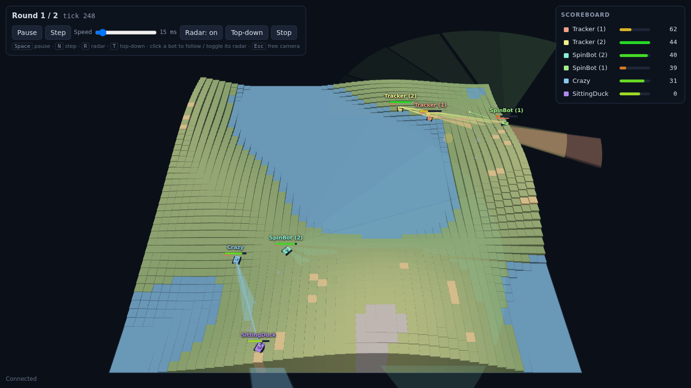
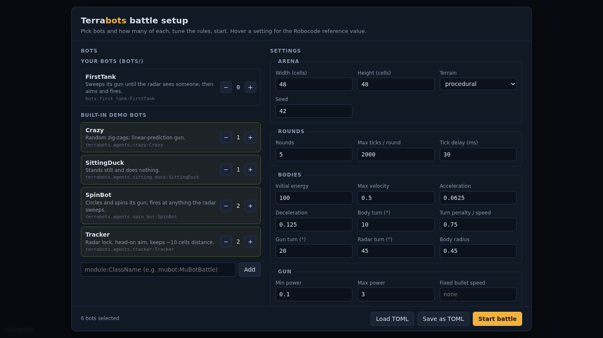
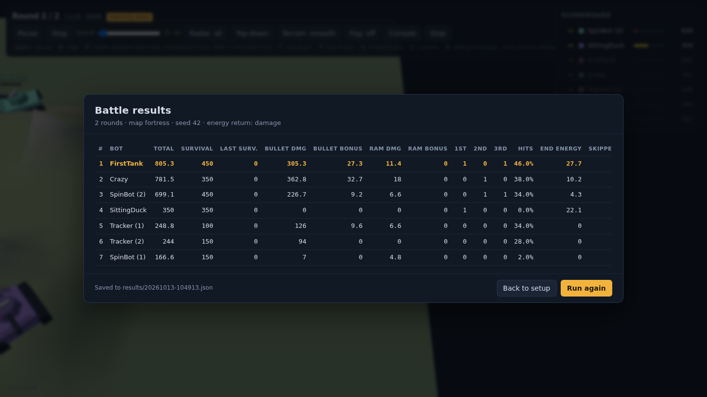

<div align="center">

# Terrabots

**Program tanks in Python. Fight on real terrain.**

A Robocode-style battle arena and agent-simulation framework for learning Python,
AI, statistics and machine learning, on a 2.5D world where hills block your radar,
high ground lets you shoot over cover, and steep slopes stop your tracks.

[](https://github.com/devbyandre/terrabots/actions/workflows/ci.yml)

[](LICENSE)

[Website](https://devbyandre.github.io/terrabots/) · [Quick start](#quick-start) · [Write a bot](#your-first-tank) · [Rules](#battle-rules) · [Spec](docs/arena-spec.md)



</div>

---

## Why Terrabots

- **One file, one bot.** Subclass `BattleAgent`, return a `BattleAction` from
  `decide()`, done. No build step, no game engine to learn.
- **Terrain is a mechanic, not decoration.** Line of sight is elevation-aware:
  hills and rock block radar and bullets, stairs give vantage, and bodies can't
  climb steep steps. Position matters as much as aim.
- **Robocode's rules, Python's ecosystem.** Body, gun and radar turn
  independently; bullets cost energy and heat the gun; rounds are scored like
  Robocode. Then plug in numpy, scikit-learn or PyTorch.
- **Built for experiments.** Seeded, deterministic battles run headless at
  thousands of ticks per second and export results as JSON/CSV for analysis.
- **Watch it live.** A browser viewer with a setup screen, a 3D battle view and
  a Robocode-style results table.

## Quick start

```bash
git clone https://github.com/devbyandre/terrabots.git
cd terrabots
python3 -m venv .venv && source .venv/bin/activate   # Windows: .venv\Scripts\activate
pip install -e ".[dev]"

terrabots-battle                    # open http://localhost:8765/ → pick bots → Start
```

Or with Docker, nothing to install but Docker itself:

```bash
docker compose up --build -d        # battle viewer  http://localhost:8765/
                                    # survival viewer http://localhost:8766/
```

Headless, for tournaments and statistics:

```bash
terrabots-battle battles/example.toml --headless
terrabots-battle --headless --rounds 50 --seed 1 \
    --bot bots.first_tank:FirstTank --bot terrabots.agents.tracker:Tracker=2
```

Example output:

```
rank  name                       total  survival    bullet     ram   1st   2nd   3rd    hit%
--------------------------------------------------------------------------------------------
   1  Tracker (1)                  936       450       394       0     1     0     1    36.0
   2  Crazy                        924       550       277       2     1     1     0    30.0
   ...
Saved results/20261012-184137.json
```

**VS Code:** open the folder, accept the recommended extensions, run the task
*Terrabots: Setup venv*, press F5 and pick a launch configuration. Breakpoints in
`decide()` work; turn time limits switch off automatically under the debugger.

## Your first tank

```python
# bots/my_tank.py
from terrabots.battle import BattleAction, BattleAgent, BattleObservation
from terrabots.battle.geometry import normalize_angle


class MyTank(BattleAgent):
    """Sweeps its gun until the radar sees someone, then aims and fires."""

    def decide(self, obs: BattleObservation) -> BattleAction:
        if not obs.scanned_bots:
            return BattleAction(velocity=0.3, body_turn=4, gun_turn=20)   # search

        enemy = obs.scanned_bots[0]
        aim = normalize_angle(enemy.bearing - obs.gun_heading)
        return BattleAction(velocity=0.3, body_turn=4, gun_turn=aim,
                            fire=2.0 if abs(aim) < 5 else 0.0)
```

Bots in `bots/` show up in the setup screen automatically. Start from
[`bots/first_tank.py`](bots/first_tank.py), then read the demo bots for the next
steps: radar lock and head-on aim in
[`tracker.py`](terrabots/agents/tracker.py), linear targeting in
[`crazy.py`](terrabots/agents/crazy.py).

**What a bot sees** (`BattleObservation`): its position, three headings, speed,
energy and gun heat; `scanned_bots` from this tick's radar sweep; events
(`hit_by_bullet`, `bullet_hit`, `bullet_missed`, `hit_wall`, `hit_bot`,
`bot_death`); messages from teammates; and a range-limited `terrain` view for
path planning. It never sees global state: other bots are known only through radar.

**What a bot does** (`BattleAction`): target `velocity`, `body_turn`, `gun_turn`,
`radar_turn` (degrees, clockwise, 0 = north) and `fire` power, all clamped by the
rules each tick.

**Persistent storage** (Robocode's data directory): `self.storage.save("stats", data)`
and `self.storage.load("stats", default)` keep small JSON files per bot class
between battles (`bot_data/`, 200 KB quota by default).

**Graphical debugging** (Robocode's `onPaint`): draw in arena coordinates with
`self.draw.line(...)`, `self.draw.circle(...)`, `self.draw.text(...)` inside
`decide()`. The viewer shows them for the bot you follow, or for all bots with
<kbd>D</kbd>. `self.rules` holds the battle's rules (`bullet_speed(power)`,
`gun_cooling_rate`, ...).

### Porting a Robocode bot

`terrabots.battle.robocode.AdvancedRobot` gives you Robocode's API: queued
commands that run over several ticks, "remaining" getters, relative bearings and
the turn-complete conditions. A Java AdvancedRobot ports almost line by line:

```python
from terrabots.battle.robocode import AdvancedRobot, ScannedRobotEvent


class MyRobot(AdvancedRobot):
    def on_round_start(self, round_number, rounds):
        self.set_adjust_radar_for_gun_turn(True)

    def tick(self):                                  # one turn of run()'s while loop
        self.set_turn_radar_right(360)
        self.set_ahead(5)

    def on_scanned_robot(self, e: ScannedRobotEvent):
        self.set_turn_gun_right(e.absolute_bearing - self.gun_heading)
        self.set_fire(2)
```

Distances are cells (1 cell = 16 px); see the module docstring for the
differences.

## Battle rules

Robocode's rules as described on RoboWiki ([Game physics](https://robowiki.net/wiki/Robocode/Game_Physics),
[Scoring](https://robowiki.net/wiki/Robocode/Scoring)), converted at 16 px per cell.
Every value is a field of [`BattleConfig`](terrabots/battle/config.py), editable in
the setup screen or a battle TOML.

| Rule | Default |
|---|---|
| Max speed / acceleration / braking | 0.5 cells/tick · 1/16 · 2/16 |
| Body turn | 10° − 0.75° per px/tick of speed |
| Gun / radar turn | 20° / 45° per tick |
| Bullet power | 0.1 – 3.0, costs that much energy |
| Bullet speed | 20 − 3·power px/tick |
| Damage | 4·p, plus 2·(p − 1) above power 1 |
| Energy back on hit | the damage dealt (or Robocode's 3·p, or none) |
| Gun heat | 1 + p/5 per shot, cools 0.1/tick |
| Radar range | 75 cells (1200 px), needs line of sight |
| Bodies | 36 × 36 px squares (2.25 cells), axis-aligned |
| Bullets | move before robots each tick; fly at muzzle height, so terrain higher than that stops them; crossing bullets destroy each other |
| Walls, rams | stop the tank; wall damage scales with speed, rams deal 0.6 each; a bot moving away isn't stopped |
| Inactivity | after 450 ticks without damage, everyone loses 0.1 energy per tick |

Scoring follows Robocode: survival, last-survivor bonus, bullet and ram damage,
and kill bonuses (20 % / 30 % of all damage done to the bot you killed). The full spec, including the design decisions and what's still
open, is in [docs/arena-spec.md](docs/arena-spec.md).

<table>
<tr>
<td></td>
<td></td>
</tr>
<tr>
<td align="center"><sub>Setup: pick bots, tune every rule, load or save TOML</sub></td>
<td align="center"><sub>Results: Robocode-style table, also saved as JSON/CSV</sub></td>
</tr>
</table>

## Use it from Python

```python
from terrabots.battle import BattleConfig, BattleRunner
from terrabots.agents.tracker import Tracker
from bots.my_tank import MyTank

config = BattleConfig(rounds=100, seed=7, terrain="procedural", hit_energy_return="robocode")
results = BattleRunner(config, [(MyTank, 1), (Tracker, 3)], time_budget_ms=None).run()

print(results.table())
rows = results.rows          # list of dicts: total, survival, bullet_damage, hit_rate, ...
results.save("results/")     # JSON + CSV for pandas / R / a spreadsheet
```

Same seed and same bots give the same results, so you can compare strategies
fairly. `BattleObservation.to_dict()` gives a flat feature vector for ML, and a
per-class `self.memory` dict survives between rounds for bots that learn.

## Survival mode

The original Terrabots mode: creatures forage food, pay metabolism, climb
terrain and shout messages to each other (range- and line-of-sight-gated).

```bash
terrabots-run                                   # viewer at http://localhost:8765/
terrabots-run --headless --ticks 500 --seed 1
terrabots-run --agent bots.wanderer:WandererAgent=10
```

Start from [`bots/wanderer.py`](bots/wanderer.py) and the `Agent` class in
[`terrabots/framework/agent.py`](terrabots/framework/agent.py).

## Built-in demo bots

| Bot | Behaviour | Good for testing |
|---|---|---|
| `SittingDuck` | does nothing | your aim |
| `SpinBot` | circles, spins its gun, fires at anything it sweeps | basic dodging |
| `Tracker` | radar lock, head-on aim, holds ~10 cells distance | movement against a steady gun |
| `Crazy` | erratic zig-zags, linear-prediction gun | both: hard to hit, hits back |
| `Walls` | drives clockwise along the arena edges, gun pointing inwards (`AdvancedRobot` example) | dealing with a wall-hugger |
| `RamFire` | charges the nearest bot and rams it | keeping distance, ram scoring |
| `Corners` | camps in the corner it survived best in, remembered across battles (`self.storage` example) | breaking a camper |
| `Learner` | orbits with random reversals; guess-factor gun that learns per opponent across battles | your movement against a learning gun |

## Project layout

```
terrabots/
  battle/          battle mode: config, physics, arena, runner, scoring, CLI
  agents/          built-in demo battle bots
  framework/       survival mode: Agent, Action, Observation, Simulation
  viewer/          browser viewers (battle.html, index.html) and their servers
  world_terrain.py grid, elevation-aware LOS, passability and climbing
  comms.py         range + LOS gated messaging
  map_generator.py procedural and flat terrain
bots/              your bots (first_tank.py, wanderer.py are templates)
battles/           battle files (TOML)
docs/              battle spec, website
tests/             pytest suite
```

## Roadmap

- [x] Survival mode, elevation-aware LOS, comms
- [x] Battle mode: physics, radar, bullets, rounds, scoring, CLI, viewer
- [ ] Teams (comms already exist) and team scoring
- [x] Bots in subprocesses for isolation and hard time limits
- [x] Robocode-style AdvancedRobot API for porting Java bots
- [ ] Map files and a map editor
- [ ] Gymnasium / PettingZoo wrapper for reinforcement learning
- [ ] Survival rules inside battles (foraging as an arena option)

## A word on safety

Bots are ordinary Python. With `bot_isolation = "process"` (the default in
`battles/example.toml`, or `--isolation process`) every bot runs in its own
process: bots think in parallel, and a bot that hangs is killed after a hard time
limit. That keeps a battle running, but it is **not a sandbox**: running someone
else's bot still means running their code, so only run bots you trust. See
[SECURITY.md](SECURITY.md).

## Contributing

Bug reports, bots, lessons and pull requests are welcome; see
[CONTRIBUTING.md](CONTRIBUTING.md).

## License

[MIT](LICENSE) © André Munzinger. Inspired by
[Robocode](https://robocode.sourceforge.io/), the tank-programming game that got
a generation of students into code. Terrabots is an independent project and not
affiliated with Robocode.
